# MarkdownView

一款**所见即所得**的 Markdown 编辑器：熟悉 Markdown 可以直接写，不熟悉可以用工具栏或菜单排版，随时可切到源码模式。

> 提示：菜单「插入」里可以直接插入表情、告警块、折叠内容、脚注和定义列表。

## 教程

这是一篇讲解如何正确使用 **Markdown** 的排版示例，学会这个很有必要，能让你的文章有更佳清晰的排版。

> 引用文本：Markdown is a text formatting syntax inspired

## 语法指导

### 普通内容

这段内容展示了在内容里面一些排版格式，比如：

- **加粗** - `**加粗**`
- *倾斜* - `*倾斜*`
- ~~删除线~~ - `~~删除线~~`
- `Code 标记` - `` `Code 标记` ``
- [超级链接](https://github.com/5faith/MarkdownView) - `[超级链接](https://github.com/5faith/MarkdownView)`
- [username@gmail.com](mailto:username@gmail.com) - `[username@gmail.com](mailto:username@gmail.com)`

### 表情符号 Emoji

支持 [GitHub 表情短代码](https://github.com/ikatyang/emoji-cheat-sheet)：`:名字:` 会显示成表情，源文件里仍保留短代码。

:smile: :heart: :rocket: :warning: :information_source: :bulb: :checkered_flag:

也支持直接输入表情字符（发送到不支持短代码的地方也不会丢）：

😄 ❤️ 🚀 ⚠️ ℹ️ 💡 🏁

### 大标题 - Heading 3

你可以选择使用 H1 至 H6，使用 `#` 打头，`#` 后面需要有空格。

#### Heading 4

##### Heading 5

###### Heading 6

### 图片

```


```

支持复制粘贴直接上传，图片会保存到 md 同级的图片目录。

### 代码块

#### 普通

```
*emphasize*    **strong**
_emphasize_    __strong__
var a = 1
```

#### 语法高亮支持

如果在 ``` 后面跟随语言名称，可以有语法高亮的效果哦，比如:

##### 演示 Go 代码高亮

```go
package main

import "fmt"

func main() {
	fmt.Println("Hello, 世界")
}
```

##### 演示 Java 高亮

```java
public class HelloWorld {

    public static void main(String[] args) {
        System.out.println("Hello World!");
    }

}
```

> Tip: 语言名称支持下面这些: `ruby`, `python`, `js`, `html`, `erb`, `css`, `coffee`, `bash`, `json`, `yml`, `xml` ...

### 有序、无序、任务列表

#### 无序列表

- Java
  - Spring
    - IoC
    - AOP
- Go
  - gofmt
  - Wide
- Node.js
  - Koa
  - Express

#### 有序列表

1. Node.js
   1. Express
   2. Koa
   3. Sails
2. Go
   1. gofmt
   2. Wide
3. Java
   1. Latke
   2. IDEA

#### 任务列表

- [X] 发布 Sym
- [X] 发布 Solo
- [ ] 预约牙医

### 表格

如果需要展示数据什么的，可以选择使用表格。

| header 1 | header 2 |
| -------- | -------- |
| cell 1   | cell 2   |
| cell 3   | cell 4   |
| cell 5   | cell 6   |

### 折叠内容

默认展开：

<details open>
<summary>这里是摘要部分。</summary>

这里是细节部分。

```js
console.log('hello')
```

</details>

默认收起：

<details>
<summary>点击展开</summary>

这里是折叠内容。

</details>

### 告警块

> [!NOTE]
> 补充信息。

> [!TIP]
> 有用建议。

> [!IMPORTANT]
> 关键信息。

> [!WARNING]
> 需要立即关注的风险。

> [!CAUTION]
> 危险操作，可能造成不可逆后果。

### 定义列表

First Term
: This is the definition of the first term.

Second Term
: This is one definition of the second term.
: This is another definition of the second term.

### 段落

空行可以将内容进行分段，便于阅读。（这是第一段）

使用空行在 Markdown 排版中相当重要。（这是第二段）

### 链接引用

[链接文本][链接标识]

[链接标识]: https://github.com/5faith/MarkdownView

```
[链接文本][链接标识]

[链接标识]: https://github.com/5faith/MarkdownView
```

### 数学公式

多行公式块：

$$
\frac{1}{\Bigl(\sqrt{\phi \sqrt{5}}-\phi\Bigr) e^{\frac25 \pi}} = 1+\frac{e^{-2\pi}}{1+\frac{e^{-4\pi}}{1+\cdots}}
$$

行内公式：公式 $a^2 + b^2 = \color{red}c^2$ 是行内。

### 图表（Mermaid）

用 ` ```mermaid ` 代码块画图，编辑区会直接渲染成图表，点右下角「源码」按钮切换回代码编辑。菜单「插入 → 图表」或工具栏的图表按钮能插入常用骨架，下面按分类列出全部支持的图表。

#### 脑图

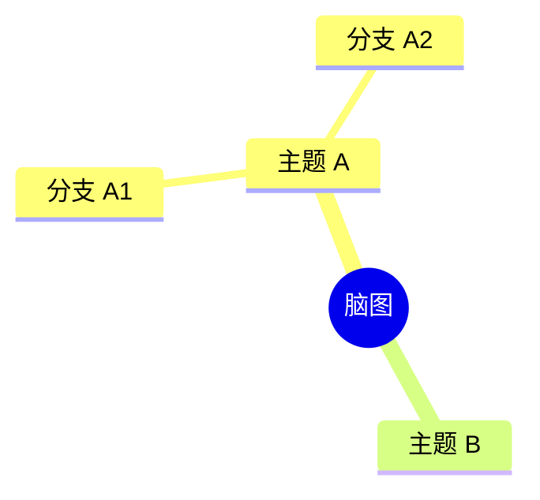

#### 流程图

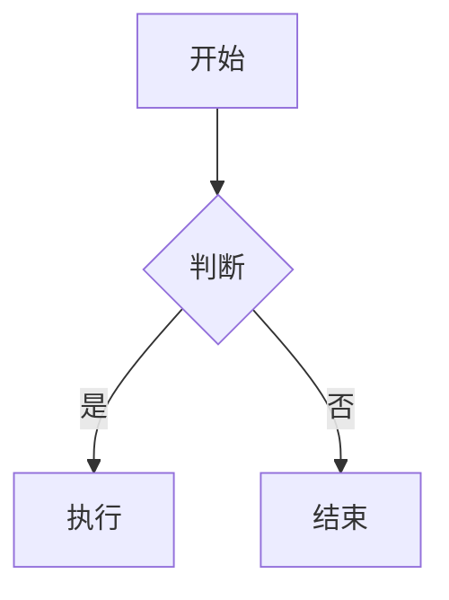

#### 流程图（ELK 布局）

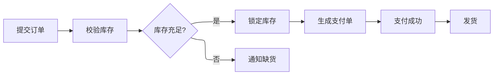

#### 时序图

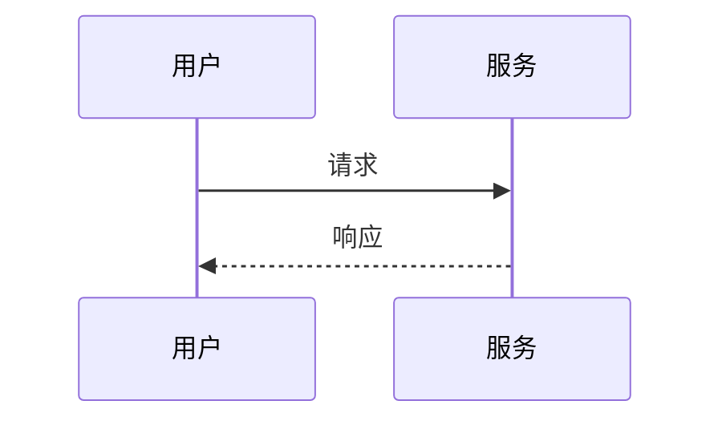

#### 泳道图

```mermaid
swimlane-beta LR
    subgraph 客户
        a[提交请求]
    end
    subgraph 支持
        b[处理请求]
    end
    a --> b
```

#### 甘特图

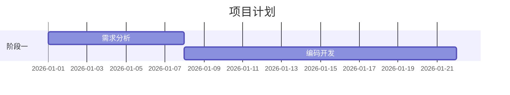

#### 时间线

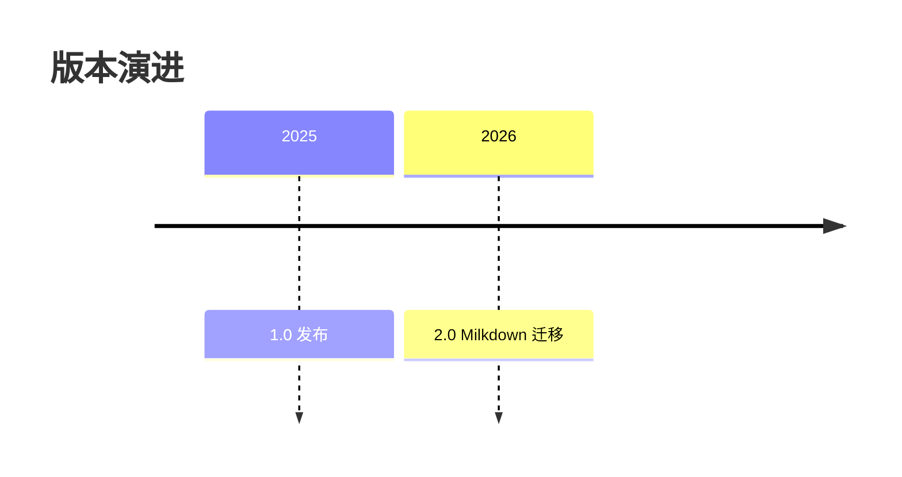

#### 图表（XY）

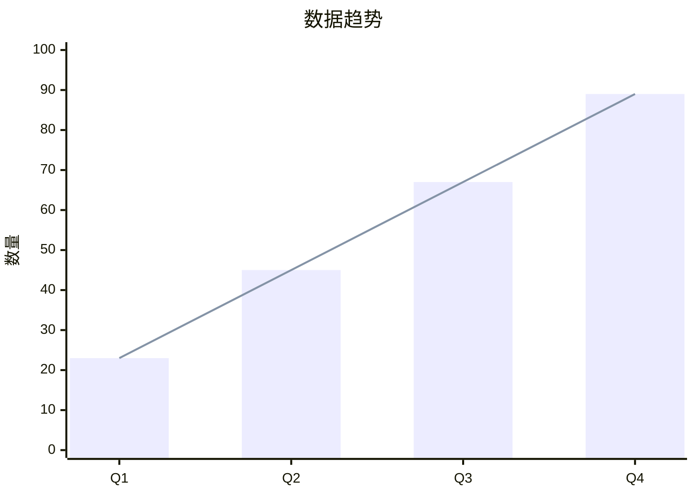

#### 象限图

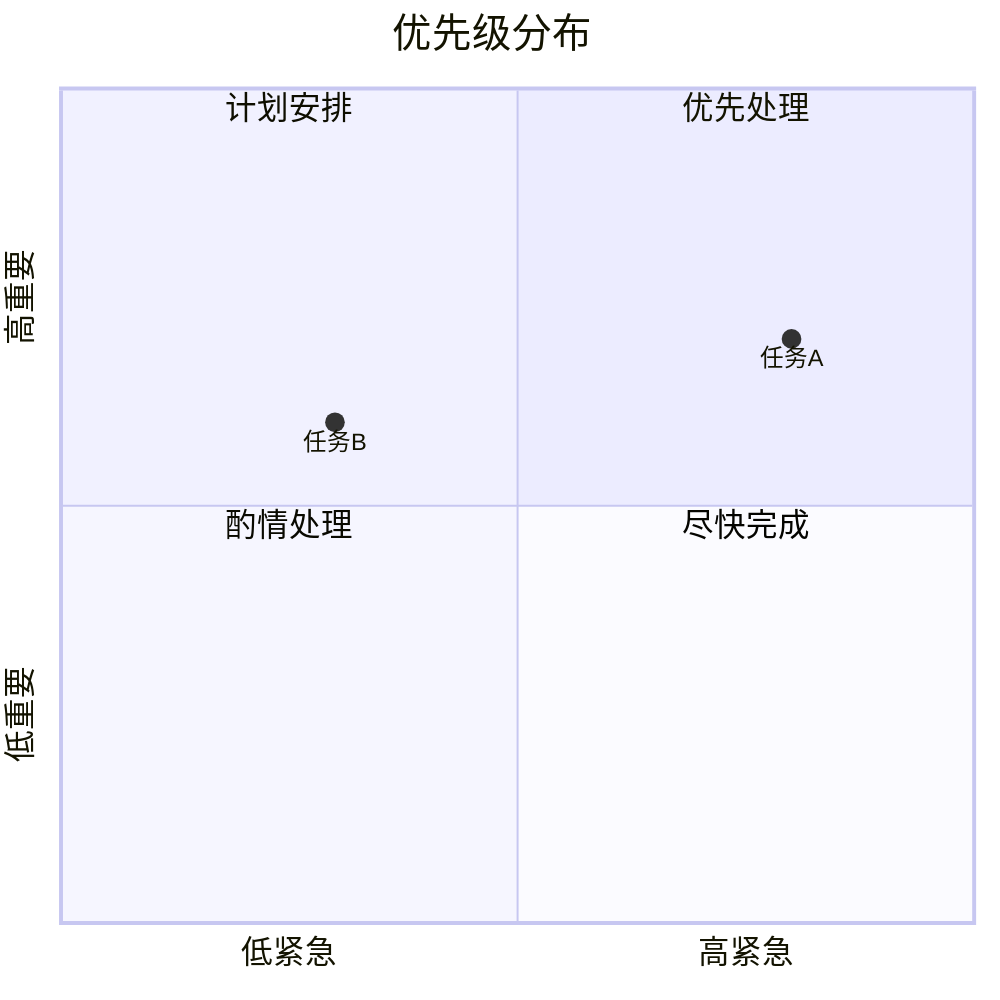

#### 需求图

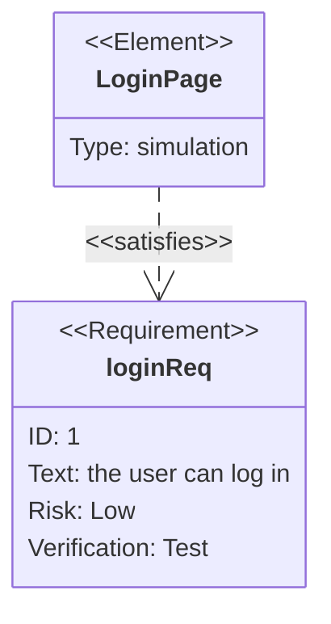

#### 类图

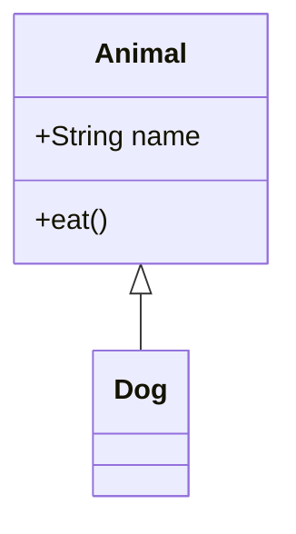

#### 状态图

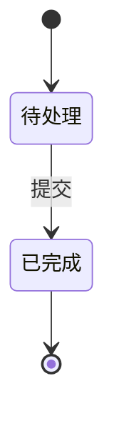

#### E-R 图

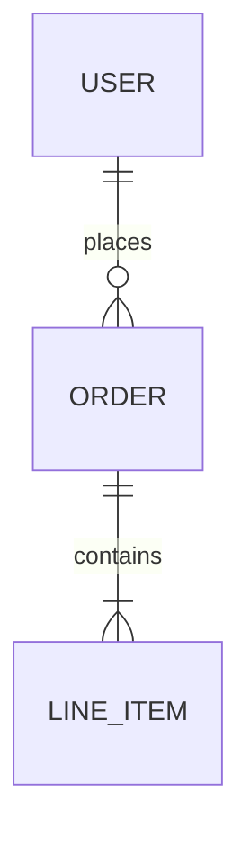

#### 饼图

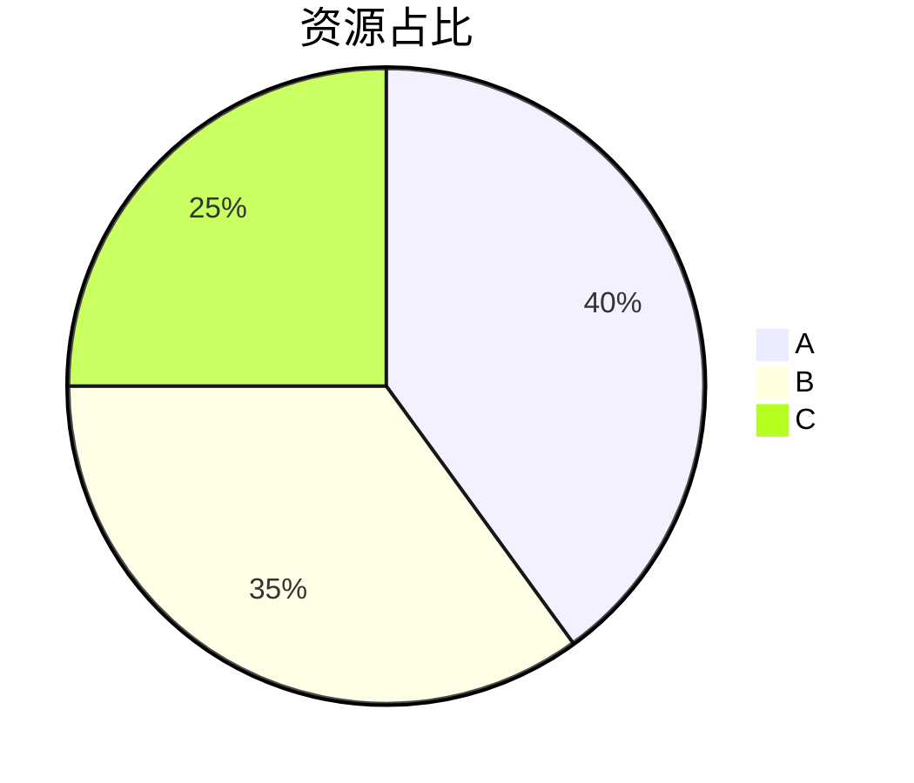

#### 韦恩图

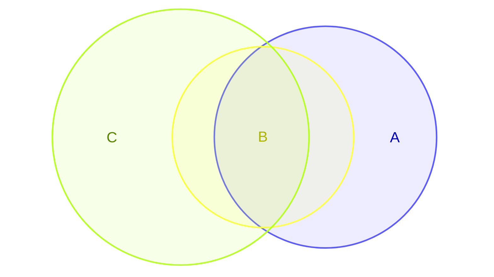

#### 用户旅程图

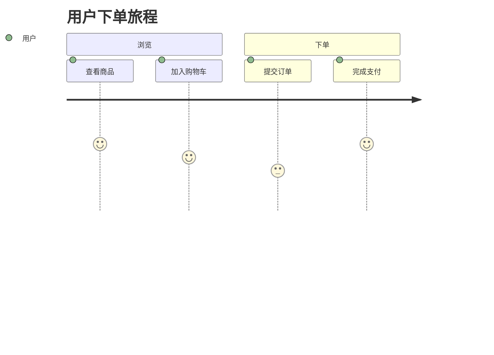

#### Git 分支图

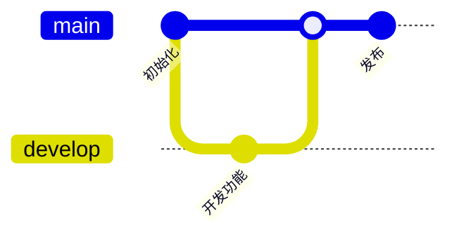

#### C4 架构图

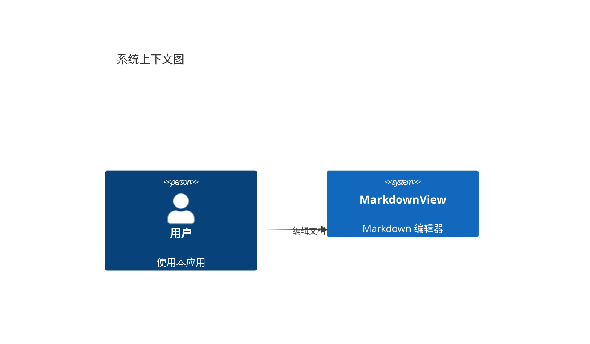

#### 架构图


#### 块图

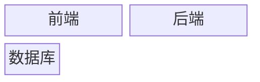

#### 网络包图

```mermaid
packet-beta
    0-7: "源端口"
    8-15: "目标端口"
    16-31: "序列号"
```

#### 桑基图

```mermaid
sankey-beta
    source,page,100
    page,signup,30
    page,leave,70
```

#### 雷达图

```mermaid
radar-beta
    axis a["速度"], b["质量"], c["成本"]
    curve c1["方案 A"]{80, 60, 70}
    curve c2["方案 B"]{60, 85, 75}
    max 100
    min 0
```

#### 看板

```mermaid
kanban-beta
    title 迭代任务
    section 待办
        编写文档: toDo
    section 进行中
        实现功能: doing
    section 完成
        需求评审: done
```

#### 鱼骨图

```mermaid
ishikawa
    problem "代码质量下降"
    cause "人员"
        effect "经验不足"
    cause "流程"
        effect "缺少评审"
```

#### 矩形树图

```mermaid
treemap-beta
    "分类 A"
        "条目 A1": 10
        "条目 A2": 20
    "分类 B"
        "条目 B1": 15
        "条目 B2": 25
```

#### 树状图

```mermaid
treeView-beta
    root
        child A
        child B
```

#### Wardley 图

```mermaid
wardley-beta
    component c1[0.5, 0.7]
```

#### 用例图

```mermaid
usecase-beta
actor User("用户")
actor Admin("管理员")
Login("登录")
ViewProfile("查看资料")
ManageUsers("管理用户")

User --> Login
User --> ViewProfile
Admin --> ManageUsers
```

#### 事件建模图

```mermaid
eventmodeling
tf 01 ui ShopUI
tf 02 cmd AddItemToCart
tf 03 evt ItemAdded
tf 04 rmo CartView ->> 03
```

#### Cynefin 图

```mermaid
cynefin-beta
  title 事件响应

  complex
    "调查根因"
    "运行混沌实验"

  complicated
    "分析指标"

  clear
    "最佳实践"

  chaotic
    "紧急处置"
```

#### 语法图（EBNF）

```mermaid
railroad-ebnf-beta
    title 表达式语法

    expression = term ( "+" term | "-" term )* ;
    term = factor ( "*" factor | "/" factor )* ;
    factor = number | "(" expression ")" ;
    number = digit+ ;
    digit = "0" | "1" | "2" | "3" | "4" | "5" | "6" | "7" | "8" | "9" ;
```

#### 语法图（ABNF）

```mermaid
railroad-abnf-beta
    title 邮箱地址

    address = local-part "@" domain ;
    local-part = 1*( ALPHA / DIGIT ) ;
    domain = label *( "." label ) ;
    label = 1*( ALPHA / DIGIT / "-" ) ;
```

#### 语法图（PEG）

```mermaid
railroad-peg-beta
    title 计算器语法

    Expression <- Term (("+" / "-") Term)* ;
    Term <- Factor (("*" / "/") Factor)* ;
    Factor <- Number / "(" Expression ")" ;
    Number <- Digit+ ;
    Digit <- "0" / "1" / "2" / "3" / "4" / "5" / "6" / "7" / "8" / "9" ;
```

### 脚注

这里是一个脚注引用[^1]，还可以有第二个脚注引用[^bignote]。

[^1]: 第一个脚注定义。

[^bignote]: 脚注定义可以写多段内容。

    缩进对齐的段落包含在这个脚注定义内，也支持**加粗**和[链接](https://github.com/5faith/MarkdownView)。

## 快捷键

| 快捷键 | 作用 |
| --- | --- |
| `Ctrl+N` | 新建 Markdown 文件 |
| `Ctrl+O` | 打开文件 |
| `Ctrl+Shift+O` | 打开文件夹 |
| `Ctrl+S` | 保存 |
| `Ctrl+Shift+S` | 另存为 |
| `Ctrl+P` | 导出 PDF |
| `Ctrl+R` | 阅读模式（`Esc` 退出） |
| `Ctrl+Shift+T` | 加载本模板 |
| `Ctrl+B` / `Ctrl+I` | 加粗 / 斜体 |
| `Ctrl+Z` / `Ctrl+Y` | 撤销 / 重做 |
| `F5` | 重新加载当前文件并刷新文件树 |
